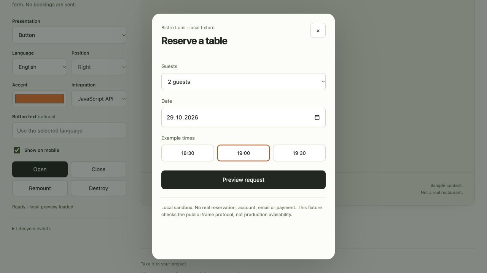

# MenüQR Widget

**Table reservations for your restaurant website.**

Four separate components. One restaurant link. No framework dependency in the core SDK.

[Try it locally](#try-it-locally) · [Integration guide](docs/integration.md) · [AI integration prompt](AI_INTEGRATION.md) · [Releases](https://github.com/Trillianti/menueqr-widget/releases)



## Pick your component

| Component             | Closed state            | Open state               |
| --------------------- | ----------------------- | ------------------------ |
| `ReservationButton`   | Button inside your page | Centered dialog          |
| `ReservationFloating` | Bottom corner launcher  | Panel above the launcher |
| `ReservationTab`      | Tab at the edge         | Side drawer              |
| `ReservationInline`   | Form in the page        | Always displayed         |

Each has its own component, JS mount function, custom element and presentation module. There is **no `mode` prop** in the new API. The components share the iframe, validation and lifecycle code. Overlay components fill the screen on narrow devices.

The reservation form is hosted by [MenüQR](https://www.menueqr.de), the same form used by the WordPress integration. Availability, guest data and restaurant approval stay in the service. This package does not contain a second booking engine.

## Connect your restaurant

Use the restaurant's **public slug or menu link**:

```ts
restaurant: 'bistro-lumi';
// or
restaurant: 'https://www.menueqr.de/menu/bistro-lumi/';
```

The SDK extracts the slug from approved MenüQR URLs. Language and tracking parameters are not copied into the integration. No internal database ID, password or private API token is needed.

For a live website, enable the widget/reservations in the restaurant's MenüQR settings with an eligible subscription and approve the website's origin. These permissions are enforced by the service; knowing the slug grants no administrative access.

## Install

Version **0.2.1** is distributed as an npm-installable archive on GitHub Releases. It is **not yet published to the npm registry**.

```sh
npm install https://github.com/Trillianti/menueqr-widget/releases/download/v0.2.1/menueqr-widget-0.2.1.tgz
```

Import it as `@menueqr/widget` after installation. Pin a release for production.

## React / Next.js

Use the JSX component directly in your page or layout. Lifecycle and cleanup are automatic; React is an optional peer dependency used only by this adapter.

```tsx
'use client';

import { ReservationFloating } from '@menueqr/widget/react';

export default function Booking() {
  return (
    <ReservationFloating
      restaurant="https://www.menueqr.de/menu/bistro-lumi/"
      language="de"
      color="#ff730a"
    />
  );
}
```

Other components from the same entry point:

```tsx
<ReservationButton restaurant="bistro-lumi" />
<ReservationTab restaurant="bistro-lumi" side="right" />
<ReservationInline restaurant="bistro-lumi" />
```

Mount the one you want. To change presentation, replace the component; to change the restaurant or styling, update its props. The core SDK never imports React.

In Next.js App Router, import the widget into your existing `app/layout.tsx` and place the JSX inside its `<body>`. The library already marks its React entry as a Client Component, so your layout can keep server metadata and other server behavior. Keep existing providers, fonts and markup. If you pass event callbacks, put that integration in a separate client wrapper. See the [Next.js component boundary guide](https://nextjs.org/docs/app/getting-started/server-and-client-components).

The playground has separate **React**, **Next.js**, **JavaScript** and **Web Component** guides with a copyable install command and complete examples. [See the layout guide](docs/screenshots/react-guide.jpg).

## JavaScript / TypeScript

```html
<div id="booking"></div>
```

```ts
import { mountReservationFloating } from '@menueqr/widget';

const widget = mountReservationFloating('#booking', {
  restaurant: 'bistro-lumi',
  language: 'de',
  color: '#ff730a',
});

// Optional controls:
widget.open();
widget.close();
widget.update({ language: 'en' });

// On component unmount / client navigation:
widget.destroy();
```

All four components are imported from the same package:

```ts
import {
  mountReservationButton,
  mountReservationFloating,
  mountReservationTab,
  mountReservationInline,
} from '@menueqr/widget';
```

Each function mounts its own component. The optional `/button`, `/floating`, `/tab` and `/inline` subpaths remain supported for existing integrations.

Mount after the target is connected. Repeated mounts of the **same component on the same target** reuse its controller. Destroy it before mounting a different component on that target. Separate targets can host independent components.

## Web Components

```ts
import { defineReservationFloatingElement } from '@menueqr/widget/element';

defineReservationFloatingElement();
```

```html
<menueqr-reservation-floating
  restaurant="bistro-lumi"
  language="de"
  color="#ff730a"
></menueqr-reservation-floating>
```

Four separate elements are available: `menueqr-reservation-button`, `menueqr-reservation-floating`, `menueqr-reservation-tab`, `menueqr-reservation-inline`. Register them individually, or call `defineReservationElements()` once. Attribute changes update configuration; disconnection releases the component. Boolean attributes use literal `"true"` / `"false"` strings.

## Try it locally

Requires Node.js **22.12+ or 24+** and npm.

```sh
git clone https://github.com/Trillianti/menueqr-widget.git
cd menueqr-widget
npm ci
npm run dev
```

Open **[127.0.0.1:4310](http://127.0.0.1:4310/)**. Its cross-origin form fixture runs on port `4311`. `Ctrl+C` stops both processes.

Choose your framework and component, enter a restaurant link or slug, then adjust appearance. React is the default and its preview renders the real React component. Select TSX or JSX to match your project.

The guide provides three steps: **install**, **add the component**, **connect the restaurant**. Copy the install command, selected layout/component example, or a framework-specific AI prompt. JavaScript target markup and Web Component registration/HTML are separate copyable files.

Switching component types destroys the previous presentation. React and Next.js guides share the same React preview, so switching between those two guides preserves its state.

By default, the form uses fictional local data and never sends a booking, email or payment. It follows the WordPress form's layout: guest counter, quick dates, time grid, contact step and pinned footer. Nine translated languages and the accent color follow your settings. No account is required for this preview.

**Live preview is an explicit opt-in.** It opens the hosted form for your chosen restaurant and needs the same allowed-origin and feature settings as a real website. A real form can submit a real reservation; use local preview for development tests.

## Use with an AI assistant

Configure the playground and click **Copy AI prompt**, or provide [AI_INTEGRATION.md](AI_INTEGRATION.md).

```ts
import { createIntegrationPrompt } from '@menueqr/widget/prompt';

const prompt = createIntegrationPrompt({
  restaurant: 'https://www.menueqr.de/menu/bistro-lumi/',
  component: 'floating', // Chooses which component the generated code imports.
  integration: 'react', // react | next | api | element
  codeLanguage: 'typescript', // typescript | javascript
  language: 'de',
});
```

The generated integration imports the selected component; it does not pass a `mode` setting to a generic widget. No account credentials belong in the code or prompt.

## Shared options

| Option                         | Default      | Meaning                                                   |
| ------------------------------ | ------------ | --------------------------------------------------------- |
| `restaurant`                   | **required** | Public slug or MenüQR menu link                           |
| `language`                     | `de`         | `de`, `en`, `fr`, `it`, `es`, `pt`, `pl`, `uk`, `tr`      |
| `color`                        | `#ff730a`    | Six-digit hex accent; launcher text contrast is automatic |
| `label`                        | Localized    | Launcher label, up to 120 characters                      |
| `side`                         | `right`      | Floating / Tab placement: `left` or `right`               |
| `offsetX`                      | `24`         | Corner launcher horizontal offset, 0–96 px                |
| `offsetY`                      | `24`         | Corner launcher bottom offset, 0–160 px                   |
| `mobile`                       | `true`       | Display on screens up to 540 px                           |
| `icon`                         | `true`       | Launcher calendar icon                                    |
| `inlineHeight`                 | `720`        | Inline height, 240–1600 px                                |
| `nonce`                        | empty        | Optional CSP nonce for isolated styles                    |
| `onOpen`, `onReady`, `onClose` | —            | Lifecycle callbacks; never guest data                     |

React components additionally accept `id`, `className`, `style` for their mounting element. Callback-only changes preserve a live iframe. Presentation is fixed by component type.

## Framework examples and checks

- [React / Next.js](examples/react/Reservations.tsx)
- [Vue / Nuxt](examples/vue/Reservations.vue)
- [Svelte](examples/svelte/Reservations.svelte)
- [Angular](examples/angular/reservations.component.ts)
- [Plain JavaScript with a bundler](examples/vanilla/main.ts)

React Strict Mode, all four React components, guide/copy flows and Vue lifecycle are exercised in browser tests. The generated Next.js layout is tested in a separate packed-package consumer, including server metadata, hydration, navigation and refresh. Svelte/Angular remain integration recipes rather than a claim of full framework certification.

```sh
npm run check
npm run format:check
npx playwright install chromium firefox webkit
npm run test:e2e
npm pack
```

The core has zero runtime dependencies and supports ESM, CommonJS and SSR-safe imports. Tests cover separate components, shared lifecycle, message source/origin checks, mobile viewports, cleanup, restaurant links and preview submissions. The suite uses isolated ports `4320` and `4321`. Mobile browser emulation does not replace physical device testing.

## Compatibility and scope

`mountReservations({ mode })` and `<menueqr-reservations mode="…">` remain available for existing **0.1.x** integrations. They are deprecated. New integrations should use the separate components above. Do not mix legacy and new components on one target without destroying the previous instance.

This repository contains the widget SDK, examples and preview tooling. The WordPress plugin and MenüQR application are maintained separately.

[Integration reference](docs/integration.md) · [Contributing](CONTRIBUTING.md) · [Security](SECURITY.md)

## License

[MIT](LICENSE) for the SDK. The hosted service has its own terms and restaurant configuration. The local preview's Inter font is licensed separately under the [SIL Open Font License](scripts/fixture/fonts/LICENSE-Inter.txt).
