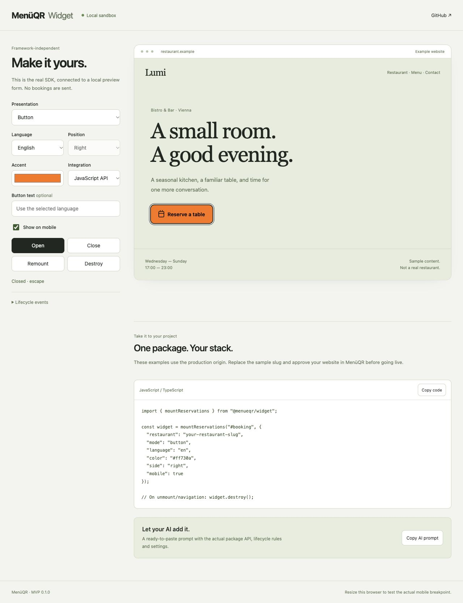

# MenüQR Widget

**A table reservation widget that fits your website.**

Four layouts. Nine languages. One small, typed API — without a framework dependency.

[Try it locally](#try-it-locally) · [Integration guide](docs/integration.md) · [AI integration prompt](AI_INTEGRATION.md) · [Releases](https://github.com/Trillianti/menueqr-widget/releases)

<!-- A screenshot of the actual local playground, not a concept render. -->



## What this package does

Mounts the MenüQR reservation form on a restaurant website. Choose an ordinary button, a floating launcher, an edge tab with a drawer, or an inline form. Overlay layouts become full-screen on small screens.

The form is served by [MenüQR](https://www.menueqr.de). Availability, booking validation and restaurant approval stay in the service. This SDK provides the website integration, presentation and lifecycle; it does not contain the backend or a second booking engine.

- **Framework independent:** JavaScript / TypeScript API and an optional Web Component.
- **Small integration surface:** `mountReservations`, `open`, `close`, `update`, `destroy`.
- **Zero runtime dependencies:** ESM, CommonJS and TypeScript declarations included.
- **SSR-safe imports:** mount in your framework's client lifecycle.
- **Isolated styles:** Shadow DOM, native dialogs, keyboard dismissal and focus restoration.
- **Lazy overlays:** no reservation iframe request until opened; inline loads when displayed.
- **Safe local preview:** the included fixture never creates a real booking or sends an email.

## Try it locally

Requires **Node.js 22.12+ or 24+** and npm.

```sh
git clone https://github.com/Trillianti/menueqr-widget.git
cd menueqr-widget
npm ci
npm run dev
```

Open **[127.0.0.1:4310](http://127.0.0.1:4310/)**. Both the playground and its cross-origin form fixture run locally; no account, credentials or live restaurant are needed. The fixture uses port `4311`.

Switch layouts, language, color, placement and API / Web Component. Open the form and submit a preview request. Copy a production integration snippet or an AI prompt directly from the playground. `Ctrl+C` stops both processes.

The preview form is deliberately fictional. It demonstrates embedding and interaction, not live restaurant availability. For a real integration, the restaurant needs reservations and the widget enabled in MenüQR, an eligible subscription and the embedding site's origin approved in its widget settings.

## Install the MVP

Version **0.1.0** is distributed as an npm-installable archive on GitHub Releases. It is **not yet published to the npm registry**.

```sh
npm install https://github.com/Trillianti/menueqr-widget/releases/download/v0.1.0/menueqr-widget-0.1.0.tgz
```

Import it as `@menueqr/widget` after installation. Pin the release when deploying; do not depend on a moving branch.

## JavaScript / TypeScript

```html
<div id="reservations"></div>
```

```ts
import { mountReservations } from '@menueqr/widget';

const widget = mountReservations('#reservations', {
  restaurant: 'your-restaurant-slug',
  mode: 'button',
  language: 'de',
  color: '#ff730a',
});

// Optional controls for your own navigation or buttons.
widget.open();
widget.close();
widget.update({ language: 'en' });

// Required when the containing component or page is removed.
widget.destroy();
```

Mount after the target is connected to the document. A second mount on the **same target** updates and returns the existing controller. Use separate targets for separate instances.

## Four layouts

| `mode`     | Closed state                  | Open state               |
| ---------- | ----------------------------- | ------------------------ |
| `button`   | Button inside your target     | Centered dialog          |
| `floating` | Bottom corner launcher        | Panel above the launcher |
| `tab`      | Tab on the left or right edge | Side drawer              |
| `inline`   | Form in the page              | Always displayed         |

On screens up to `540px` wide, the three overlay layouts use a full-screen dialog. The edge tab becomes a bottom launcher. Use `side: 'left'` to change placement, or `mobile: false` to hide the widget on small screens.

## Web Component

Registration is explicit, so importing the module during SSR is safe.

```ts
import { defineReservationsElement } from '@menueqr/widget/element';

defineReservationsElement();
```

```html
<menueqr-reservations
  restaurant="your-restaurant-slug"
  mode="floating"
  language="de"
  color="#ff730a"
  side="right"
></menueqr-reservations>
```

Attribute changes update the widget; removing the element cleans it up. Boolean attributes use the literal strings `"true"` and `"false"`. See the [full attribute and event reference](docs/integration.md#web-component).

## Use with an AI coding assistant

Give your assistant [AI_INTEGRATION.md](AI_INTEGRATION.md), or configure the playground and click **Copy AI prompt**. The generated prompt contains the selected layout, an exact installation URL and the real lifecycle API.

```ts
import { createIntegrationPrompt } from '@menueqr/widget/prompt';

const prompt = createIntegrationPrompt({
  restaurant: 'your-restaurant-slug',
  mode: 'floating',
  language: 'de',
});
```

No email, password, API secret or account token belongs in a widget integration. The restaurant slug is public.

## Frameworks

Use the client lifecycle of your framework and call `destroy()` during cleanup. Examples:

- [React and Next.js](examples/react/Reservations.tsx)
- [Vue and Nuxt](examples/vue/Reservations.vue)
- [Svelte](examples/svelte/Reservations.svelte)
- [Angular](examples/angular/reservations.component.ts)
- [Plain HTML with a bundler](examples/vanilla/main.ts)

React Strict Mode and Vue are exercised in the browser integration suite. The other recipes illustrate lifecycle integration; they are not a claim that every framework, theme or CSP configuration has been tested.

## Options

| Option         | Default      | Meaning                                                   |
| -------------- | ------------ | --------------------------------------------------------- |
| `restaurant`   | **required** | Public restaurant slug, not a URL                         |
| `mode`         | `button`     | `button`, `floating`, `tab`, `inline`                     |
| `language`     | `de`         | `de`, `en`, `fr`, `it`, `es`, `pt`, `pl`, `uk`, `tr`      |
| `color`        | `#ff730a`    | Six-digit hex accent; launcher text contrast is automatic |
| `label`        | Localized    | Override the launcher label, max 120 characters           |
| `side`         | `right`      | `left` or `right`                                         |
| `offsetX`      | `24`         | Corner launcher horizontal offset, 0–96 px                |
| `offsetY`      | `24`         | Corner launcher bottom offset, 0–160 px                   |
| `mobile`       | `true`       | Show on screens up to 540 px                              |
| `icon`         | `true`       | Show the launcher's calendar icon                         |
| `inlineHeight` | `720`        | Inline form height, 240–1600 px                           |
| `nonce`        | empty        | Optional CSP nonce for injected widget styles             |
| `onOpen`       | —            | Overlay opened                                            |
| `onReady`      | —            | Trusted form reports readiness, once per frame            |
| `onClose`      | —            | Overlay closed; receives `{ reason }`                     |

Advanced local fixture configuration, CSP guidance, events and limitations are in the [integration guide](docs/integration.md).

## Development and verification

```sh
npm run check                     # Types, unit tests, build, ESM/CJS/SSR checks
npm run format:check
npx playwright install chromium firefox webkit
npm run test:e2e                  # Desktop engines + mobile browser viewports
npm pack                         # Reproducible installable artifact
```

The browser suite uses separate ports `4320` and `4321` and local fixture data. It covers all layouts, lifecycle cleanup, iframe message validation, multiple dialogs, mobile sizing, failure fallback and React / Vue integration. Mobile browser viewports do not replace native device testing.

See [CONTRIBUTING.md](CONTRIBUTING.md) and [SECURITY.md](SECURITY.md). This public repository contains only the widget SDK, its examples, docs and preview tooling. WordPress and the MenüQR application are maintained separately.

## License

[MIT](LICENSE) for this SDK. Access to the hosted MenüQR service is separate and governed by the service's terms and restaurant configuration.
